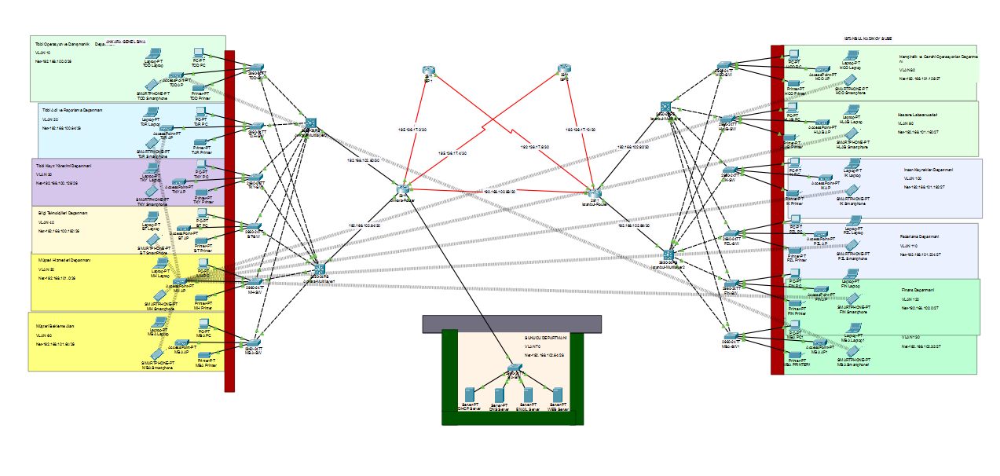
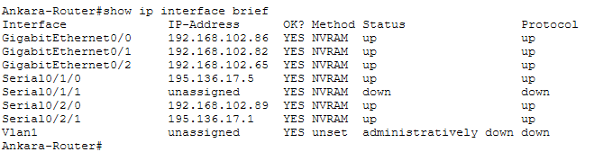
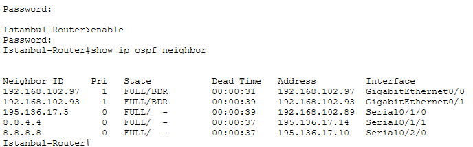
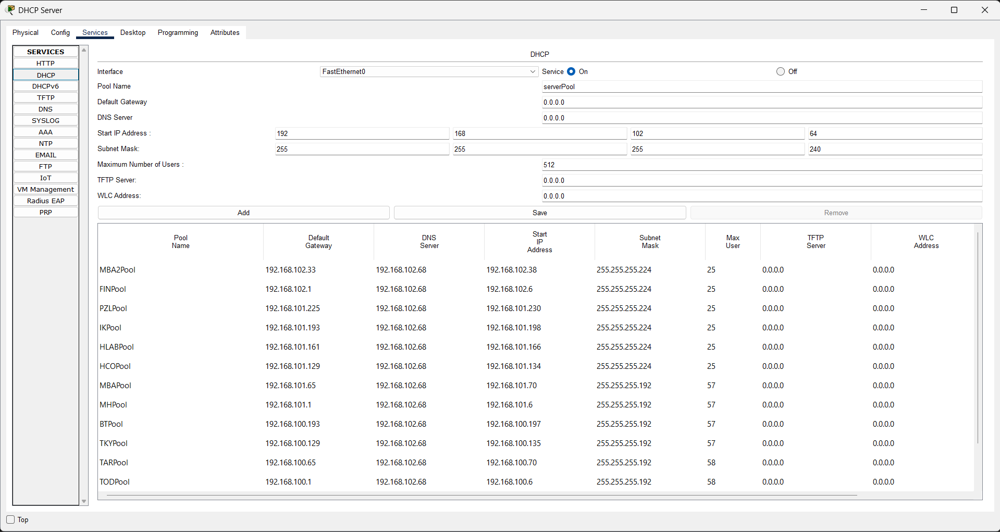
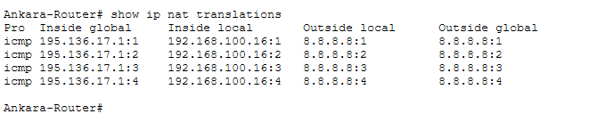
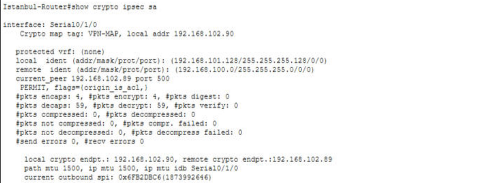

# Hastane Kurumsal Ağ Projesi (Cisco Packet Tracer)

Ankara'daki genel bina (merkez) ile İstanbul Kadıköy'deki şubeden oluşan bir hastane için tasarlanmış kurumsal ağ. Proje, Bilgi İşlem stajım sırasında Cisco Packet Tracer üzerinde adım adım kuruldu ve test edildi.

Senaryo ve gereksinimler Guru Tech Networking Training kanalındaki hastane ağı projesine dayanmaktadır; topoloji, adresleme ve tüm cihaz yapılandırmaları bu çalışmada tarafımdan yapılmıştır.

## Topoloji

| Bileşen | Model / Adet |
|---|---|
| Kurum yönlendiricileri | Ankara-Router, Istanbul-Router (Cisco 2911) |
| İnternet servis sağlayıcıları | ISP1, ISP2 (Cisco 2811) |
| Çok katmanlı anahtarlar | 4 × Cisco 3650 (her lokasyonda 2) |
| Erişim anahtarları | 13 × Cisco 2960 |
| Sunucular | DHCP, DNS, Web, Mail |
| Uç cihazlar | Her birimde bilgisayar, dizüstü, yazıcı, erişim noktası ve akıllı telefon |

Toplamda yaklaşık 85 cihaz bulunmaktadır. Ankara'da 6, İstanbul'da 6 birim olmak üzere 12 birim ayrı VLAN'larda çalışır.

## Kullanılan teknolojiler

- **VLAN ve 802.1Q trunk:** Her birim kendi VLAN'ında (Ankara 10–60, İstanbul 80–130, sunucular 70).
- **VLAN'lar arası yönlendirme:** Çok katmanlı anahtarlarda SVI arayüzleri.
- **OSPF:** Süreç 10, alan 0; iki lokasyon ve servis sağlayıcılar arasında dinamik yönlendirme.
- **DHCP:** Merkezi DHCP sunucusu, çok katmanlı anahtarlarda `ip helper-address`.
- **DNS, Web ve Mail sunucuları:** VLAN 70 içinde statik adreslerle.
- **Kablosuz ağ:** Birime özel SSID ve WPA2-PSK (AES).
- **Cihaz güvenliği:** Yalnızca SSH ile uzaktan erişim, giriş uyarı mesajı (banner), `service password-encryption`, port güvenliği (sticky MAC).
- **Yedekli internet çıkışı:** İki servis sağlayıcı ve yönetimsel uzaklığı 70 olan yedek (floating) varsayılan rota.
- **PAT (NAT overload):** Standart ACL ile iç ağların tek dış adres üzerinden internete çıkışı.
- **Site-to-Site IPsec VPN:** ISAKMP (AES-256, pre-shared key, DH grup 5), ESP-AES + SHA-HMAC dönüşüm kümesi, ACL 110 ile tanımlanan trafik.

## IP adres planı

| Lokasyon | Birim | VLAN | Ağ adresi | Ağ geçidi |
|---|---|---|---|---|
| Ankara | Tıbbi Operasyon ve Danışmanlık (TOD) | 10 | 192.168.100.0/26 | 192.168.100.1 |
| Ankara | Tıbbi Acil ve Raporlama (TAR) | 20 | 192.168.100.64/26 | 192.168.100.65 |
| Ankara | Tıbbi Kayıt Yönetimi (TKY) | 30 | 192.168.100.128/26 | 192.168.100.129 |
| Ankara | Bilgi Teknolojileri (BT) | 40 | 192.168.100.192/26 | 192.168.100.193 |
| Ankara | Müşteri Hizmetleri (MH) | 50 | 192.168.101.0/26 | 192.168.101.1 |
| Ankara | Müşteri Bekleme Alanı (MBA) | 60 | 192.168.101.64/26 | 192.168.101.65 |
| Ankara | Sunucular (DHCP .67, DNS .68, Mail .69, Web .70) | 70 | 192.168.102.64/28 | 192.168.102.65 |
| İstanbul | Hemşirelik ve Cerrahi Operasyonları (HCO) | 80 | 192.168.101.128/27 | 192.168.101.129 |
| İstanbul | Hastane Laboratuvarları (HLAB) | 90 | 192.168.101.160/27 | 192.168.101.161 |
| İstanbul | İnsan Kaynakları (İK) | 100 | 192.168.101.192/27 | 192.168.101.193 |
| İstanbul | Pazarlama (PZL) | 110 | 192.168.101.224/27 | 192.168.101.225 |
| İstanbul | Finans (FİN) | 120 | 192.168.102.0/27 | 192.168.102.1 |
| İstanbul | Misafir Bekleme Alanı 2 (MBA2) | 130 | 192.168.102.32/27 | 192.168.102.33 |

| Bağlantı | Ağ adresi |
|---|---|
| Ankara – İstanbul (seri hat, VPN) | 192.168.102.88/30 |
| Ankara – çok katmanlı anahtarlar | 192.168.102.80/30, 192.168.102.84/30 |
| İstanbul – çok katmanlı anahtarlar | 192.168.102.92/30, 192.168.102.96/30 |
| Ankara – ISP1 / ISP2 | 195.136.17.0/30, 195.136.17.4/30 |
| İstanbul – ISP1 / ISP2 | 195.136.17.8/30, 195.136.17.12/30 |

## Doğrulama

**Ankara yönlendiricisinin arayüz adresleri**

**OSPF komşulukları (İstanbul yönlendiricisi):** iki çok katmanlı anahtar, Ankara ve iki servis sağlayıcı ile komşuluklar FULL durumunda.

**DHCP havuzları:** 12 birim için ayrı adres havuzları.

**PAT:** TOD birimindeki bilgisayarın iç adresi, internete çıkarken yönlendiricinin dış adresine çevriliyor.

**IPsec VPN:** Ankara ile İstanbul arasındaki tünelde şifrelenen ve çözülen paket sayıları.

## Projeyi açma

1. Cisco Packet Tracer'ı açın (proje 9.0.1 sürümüyle hazırlandı).
2. `HASTANE_SON.pkt` dosyasını açın.
3. Ağ cihazlarının konsol ve enable parolası laboratuvar ortamı için `cisco` olarak ayarlanmıştır.

## Hazırlayan

Mesut Mert, Fırat Üniversitesi Yönetim Bilişim Sistemleri
